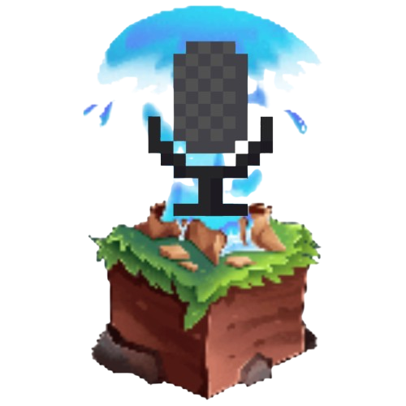

<p align="center">
  
</p>

# Svg-App

Svg-App is the official Android companion for [SimpleVoice-Geyser](https://github.com/TheodoreMeyer/SimpleVoice-Geyser), bringing voice and server chat to Bedrock players.

> **Development status:** Preparing Svg-App 1.1.0 for the official SimpleVoice-Geyser 0.1.5 release and final compatibility fixes.

## What's new in 1.1.0

- **Opus audio:** native Opus microphone encoding and `svg-v2` spatial playback, with PCM fallback when the server allows it.
- **Minecraft-inspired UI:** Now the svg-app matches the UI from the Simple Voice Geyser plugin, with textured backgrounds, beveled controls, and dedicated Voice and Chat tabs.
- **Four languages:** English, Polski, Italiano, and Español. By default and if it's available, the svg-app will follow your device language, otherwise, you can choose one of the current available options and switch during a call without having to reconnect.
- **Improved push-to-talk:** inline hold-to-talk and fullscreen controls, with screen-reader support.
- **Localized notifications:** mute, change audio output, reply to chat, or leave the call from Android's notification controls.
- **Connection updates:** support for upcoming 0.1.5 and Velocity server switching, alongside existing 0.1.4 and 0.1.3 compatibility.
- **Clearer call controls:** connection status, microphone and playback details, and a separate diagnostics panel, with layouts that accommodate large text and landscape.
- **App optimization:** Previously the app had unnecessary architecture compatibility, this has been dropped and it's now lighter for all devices.

## Download
For most users, you should just download the latest apk available from [Releases](https://github.com/TheodoreMeyer/Svg-App/releases)

## Getting started

Requires **Android 7.0 or later** and a SimpleVoice-Geyser server with app/web access enabled.

1. Install an APK (always recommended to install latest) from [Releases](https://github.com/TheodoreMeyer/Svg-App/releases), or build it from source.
2. Enter the server's web address, username, and password. Use the SimpleVoice-Geyser web port, not the Minecraft gameplay port.
3. Tap **Join**, grant microphone permission to speak, and choose Open mic or push-to-talk.

You can save your credentials, test your microphone before joining, and switch between speaker and phone earpiece. Voice and chat controls remain accessible from either tab.

PTT stops when the app is backgrounded. The notification's **Unmute** action enables Open mic so you can speak while the app is in the background.


## Build from source

With Flutter and the Android SDK installed, run from the project directory:

```sh
flutter pub get
flutter build apk --release --target-platform=android-arm64 --split-debug-info=build/symbols/arm64-v8a
```

The APK is generated at `build/app/outputs/flutter-apk/app-release.apk`. Keep the matching files from `build/symbols/arm64-v8a/` for crash diagnosis. The current configuration signs release-mode builds with the existing debug key.

## Credits

Textures and shared wording are credited in [assets/NOTICE.md](assets/NOTICE.md). Press Start 2P is bundled under the [SIL Open Font License](assets/fonts/OFL.txt).

